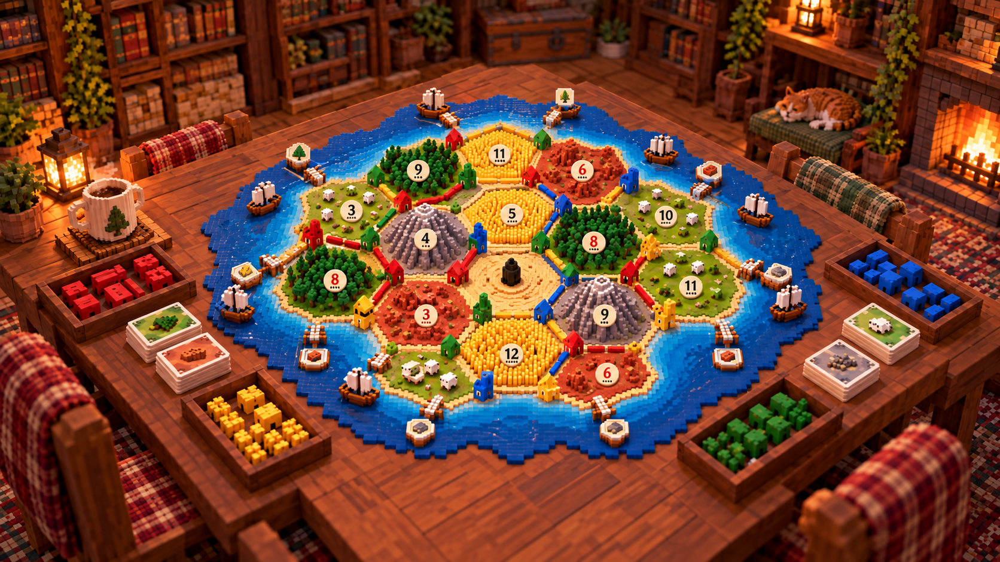

# Reign

A micro-voxel, multiplayer take on the classic settle-trade-build board game, played in the
browser. Phase one is the complete base game: 2–4 players (up to 8 in Reign Extended), humans or bots,, the random
19-tile island with harbors, setup snake draft, dice production, the robber, development
cards, longest road and largest army, bank/harbor and player-to-player trading, and a win at
10 points.



## Two modes

The host picks the mode in the lobby.

- **Classic** is the standard game above, exactly as it has always played: the random 19-tile
  island, standard rules, 10 points to win.
- **Reign Extended** adds characters, other islands and custom maps, and is where new
  resources, buildings and pieces will land.
  - *Characters:* each player picks one of eight (no two alike); each trait bends one rule
    for them, such as 3:1 bank trades, cheaper cities or stealing two cards.
  - *Islands:* six shapes from the classic isle up to a 37-tile realm, a ring round a lagoon,
    twin highlands and a winding coast. Terrains, numbers and harbors are dealt fresh each game.
  - *Map maker:* paint your own island of any size (fixed or random tiles), save it in your
    browser and share it as a short code.
  - *Random islands:* pick a size (12 to 240 tiles), a shape (round, long, ragged, or several
    islands joined by land bridges) and lakes, and generate until you like it. Everyone in
    the lobby sees each island, and Reroll grows another of the same kind.
  - *Points to win:* 8, 10, 12 or 14, or any number from 3 to 30, capped by the island and
    the table: at most two points per tile each player has, plus two (so 19 tiles and four
    players go to 11, 30 tiles and six players to 12). Goals past 10 come with an extra
    settlement, city and two roads for every two points.
  - *Bigger tables:* an island seats one player per five tiles, from four up to eight (so
    25 tiles seat five, 30 seat six and 40 seat eight), in eight colors. Five or six players
    get the 5–6 player extension's bank (24 of each resource) and deck, seven or eight a
    bigger one still (29 of each, 43 cards).

The picture above is the visual target. Everything in the world is made of voxels and meshed
at runtime: the island, the pieces, the dice, the table and the cozy room around it.

## Play locally

```bash
pnpm install
pnpm dev          # game server on :8787 + Vite on :5173 (open http://localhost:5173)
```

Click **Create a game**, then **Copy invite link** and send it to friends on the same network (open the game via your PC's LAN address, e.g. `http://192.168.1.20:5173`, so the link points there),
or click **Quick game vs 3 bots** to play solo.

### Dev cheats

Under `pnpm dev` the server starts with `--dev`, and every game gets a cheat panel: press `` ` ``
or click the hammer under the menu button. It hands any player cards or a playable development
card, rigs the next roll (2 to 12), finishes the setup for everyone, makes bots play fast and
wins the game on the spot. Each use leaves a `[cheat]` line in the chronicle. `pnpm start` (and
anything with `NODE_ENV=production`) never turns it on, and the server refuses cheat messages
there.

Production build (one process serves the page and the WebSocket):

```bash
pnpm build
pnpm start        # http://localhost:8787 (PORT env var to change)
```

## Run with Docker

```bash
docker compose up -d --build        # the game on http://localhost:8787 (PORT=9000 to change)
docker compose down                 # stop it
```

The image builds the client and runs the production server as one small container (no dev
cheats, runs as a non-root user, health check on `/health`). Without compose:
`docker build -t reign .` then `docker run -p 8787:8787 reign`.

For development without installing Node or pnpm, `docker compose --profile dev up --build`
runs `pnpm dev` from your working copy: Vite with hot reload on http://localhost:5173 and the
game server with dev cheats on.

The same image deploys as a single web service on any host that supports WebSockets (Fly.io,
Railway, a VPS…). `render.yaml` deploys to Render without Docker.

## Controls

- Drag to rotate the table, right-drag (or two fingers) to pan, wheel/pinch to zoom.
- Glowing gems and rings mark where you can build; hover to preview the piece, click to place it.
- During setup and when moving the robber, the board highlights the valid spots for you.
- `Esc` cancels build mode or closes the trade panel, and otherwise opens the game menu (how to play, settings, leave). In a game against bots the menu pauses the table.

## How it's built

```
src/shared/   rules engine, board geometry, bots, network protocol (no DOM, no Three.js)
  board/        hex math, topology (vertices/edges/harbors derived from the map), map generator
  rules/        config (resources, costs, decks), engine (applyAction), queries, view redaction, bot
src/server/   Node HTTP + WebSocket server: rooms, lobby, seats, reconnection, bots, static files
src/client/   Vite + Svelte 5 interface over a Three.js scene
  scene/        voxel engine (grid, mesher with baked AO, beveled voxel shader), island terrain,
                piece models, room, lighting, camera rig, dice, particles, post-processing
  ui/           Svelte components: home, lobby, HUD (players, hand, actions, trade, log, dialogs)
tests/        engine tests, including 75 complete simulated bot games per run
scripts/      browser screenshot and end-to-end helpers
```

- **The server is authoritative.** Clients send actions; the server validates them with the
  shared engine and sends each player a redacted view (other hands become counts, the deck
  and dice seed are never sent).
- **The engine is pure.** `applyAction(state, player, action)` returns a new state plus events.
  Events drive animations, sounds and the chronicle.
- **Maps are data.** A `Board` is just hexes (terrain + number) and harbors; topology is derived.
  Custom maps only need a different `Board`.
- **Content is data.** Resources, terrains, costs and the development deck live in
  `src/shared/rules/config.ts`.

### Hooks for the next phases

- *Characters:* `rules/characters.ts` lists them; traits hook in through `costOf`,
  `tradeRatios`, `discardLimit` and `longestRoadMin` in `rules/queries.ts` and a few lines
  in the engine (robber, 7s, setup). Portraits are voxel busts in `scene/portraits.ts`.
- *More resources, tiles, buildings, robber-like entities:* extend the lists in `config.ts`,
  add terrain builders in `scene/board/terrain.ts` and models in `scene/board/models.ts`.
  Gate them on `state.mode === 'extended'` so Classic stays standard.
- *Maps:* `board/maps.ts` holds the presets (drawn as text) and custom-map checks;
  `generateBoard(tiles, rng)` deals any shape. The table grows to fit bigger islands.
- *Day/night:* `Lighting.night` (0–1) dims the sun and boosts flames; voxel materials receive
  `uNight`, and windows on settlements and cities are emissive.

## Tests

```bash
pnpm test         # rules engine + full simulated games
pnpm check        # Svelte/TypeScript checks
node scripts/e2e.mjs http://localhost:8787 test-results/e2e 300   # browser smoke test (needs a running server)
```
